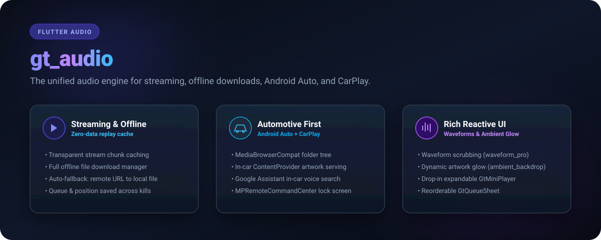
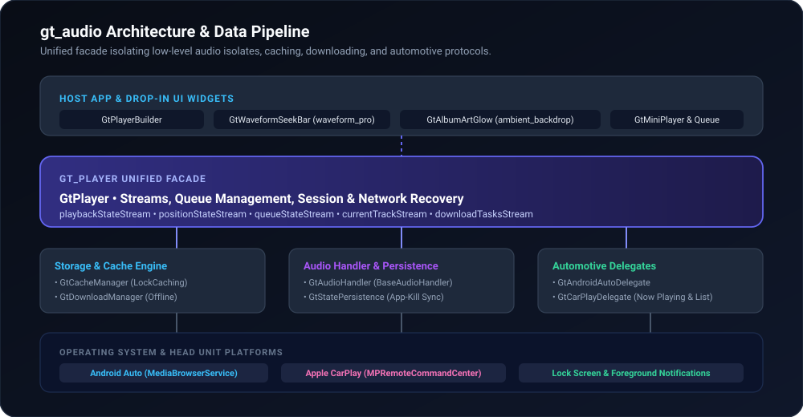

<p align="center">
  
</p>

<p align="center">
  <a href="https://pub.dev/packages/gt_audio"></a>
  <a href="https://pub.dev/packages/gt_audio/score"></a>
  <a href="https://github.com/govindtank/gt_audio/blob/main/LICENSE"></a>
  <a href="https://pub.dev/packages/gt_audio"></a>
  <a href="https://github.com/sponsors/govindtank"></a>
  <a href="https://buymeacoffee.com/govindtanko"></a>
</p>

---

## Overview

**`gt_audio`** is a production-ready, unified audio player package for Flutter that combines **streaming**, **transparent chunk caching**, **offline file downloads**, **background playback**, **lock screen media controls**, **Android Auto**, and **Apple CarPlay** behind a clean, single-point reactive facade API (`GtPlayer`).

Built on proven low-level primitives (`just_audio` + `audio_service` + `audio_session`), `gt_audio` removes the boilerplate glue code and adds critical production capabilities like automatic stream-caching (replays consume zero data), state persistence across app kills, network retry guards, and drop-in interactive UI widgets.

---

## Architecture Blueprint

<p align="center">
  
</p>

---

## Prerequisites (Checklist Before You Start)

Ensure your development environment and target platforms meet the following baseline requirements:

| Platform | Minimum Requirement | Notes |
| :--- | :--- | :--- |
| **Flutter SDK** | `>=3.24.0` | Compatible with Flutter 3.24 through Flutter 3.50+ |
| **Dart SDK** | `>=3.5.0` | Uses modern Dart features and type safety |
| **Android** | `minSdkVersion = 21`, `compileSdk = 34` | Requires Foreground Service Media Playback permission |
| **iOS** | `iOS 13.0` minimum target | Requires `audio` UIBackgroundModes declared in `Info.plist` |

---

## Platform Configuration

### 1. Android Setup

Open `android/app/src/main/AndroidManifest.xml` and add the required permissions and service declarations inside `<manifest>`:

```xml
<manifest xmlns:android="http://schemas.android.com/apk/res/android">
    <!-- Permissions -->
    <uses-permission android:name="android.permission.INTERNET"/>
    <uses-permission android:name="android.permission.WAKE_LOCK"/>
    <uses-permission android:name="android.permission.FOREGROUND_SERVICE"/>
    <uses-permission android:name="android.permission.FOREGROUND_SERVICE_MEDIA_PLAYBACK"/>

    <application>
        <!-- Audio Service Activity & Background Daemon -->
        <activity
            android:name="com.ryanheise.audioservice.AudioServiceActivity"
            android:exported="true"
            android:launchMode="singleTop">
        </activity>

        <service
            android:name="com.ryanheise.audioservice.AudioService"
            android:foregroundServiceType="mediaPlayback"
            android:exported="true">
            <intent-filter>
                <action android:name="android.media.browse.MediaBrowserService"/>
            </intent-filter>
        </service>

        <receiver
            android:name="androidx.media.session.MediaButtonReceiver"
            android:exported="true">
            <intent-filter>
                <action android:name="android.intent.action.MEDIA_BUTTON"/>
            </intent-filter>
        </receiver>
    </application>
</manifest>
```

### 2. iOS Setup

Open `ios/Runner/Info.plist` and add background audio execution:

```xml
<key>UIBackgroundModes</key>
<array>
    <string>audio</string>
</array>
```

If you stream over plain `http://` (non-SSL), also enable arbitrary loads:

```xml
<key>NSAppTransportSecurity</key>
<dict>
    <key>NSAllowsArbitraryLoads</key>
    <true/>
</dict>
```

---

## Quickstart (3-Minute Setup)

### 1. Initialize Player

Call `GtPlayer.init()` once during application startup:

```dart
import 'package:flutter/material.dart';
import 'package:gt_audio/gt_audio.dart';

void main() async {
  WidgetsFlutterBinding.ensureInitialized();

  await GtPlayer.init(
    config: const GtAudioConfig(
      androidNotificationChannelName: 'Music Player',
      autoPersistState: true,
      enableTransparentCaching: true,
    ),
  );

  runApp(const MyApp());
}
```

### 2. Queue & Play Audio

```dart
final player = GtPlayer.instance;

// Load playlist
await player.setQueue([
  GtTrack(
    id: 'track-1',
    title: 'Neon Nights',
    artist: 'Synthwave Prodigy',
    album: 'Future Horizon',
    audioUri: Uri.parse('https://example.com/audio/neon_nights.mp3'),
    artUri: Uri.parse('https://example.com/images/cover.jpg'),
  ),
  GtTrack(
    id: 'track-2',
    title: 'Midnight Drive',
    artist: 'Cyber Pulse',
    audioUri: Uri.parse('https://example.com/audio/midnight.mp3'),
  ),
]);

// Playback controls
await player.play();
await player.pause();
await player.skipToNext();
await player.seek(const Duration(seconds: 45));
```

### 3. Build UI with Drop-in Widgets

`gt_audio` includes drop-in reactive widgets powered by your favorite ecosystem packages:

```dart
GtPlayerBuilder(
  builder: (context, player, state) {
    return Column(
      children: [
        // Album art with dynamic ambient glow (powered by ambient_backdrop_glow)
        const GtAlbumArtGlow(size: 260),

        Text(state.currentTrack?.title ?? 'No Track Playing'),
        Text(state.currentTrack?.artist ?? ''),

        // Interactive Waveform Seek Bar (powered by waveform_pro)
        const GtWaveformSeekBar(height: 56),

        // Playback Controls Row
        const Row(
          mainAxisAlignment: MainAxisAlignment.center,
          children: [
            GtSkipButton.previous(),
            GtPlayPauseButton(size: 64),
            GtSkipButton.next(),
          ],
        ),
      ],
    );
  },
)
```

---

## Features & Deep Dives

### ⚡ 1. Transparent Stream Caching (`GtCacheManager`)
When streaming online tracks, `gt_audio` automatically downloads and caches chunks to disk via `LockCachingAudioSource`. Subsequent replays of the same song read directly from local cache with **0 KB cellular data usage**.

### 💾 2. Offline Download Manager (`GtDownloadManager`)
Full playlist and track downloading with background progress streams, pause/resume, and automatic fallback:

```dart
// Start offline download
await GtPlayer.instance.downloadTrack(track);

// Observe download progress
GtPlayer.instance.downloadTasksStream.listen((tasks) {
  final task = tasks[track.id];
  if (task != null) {
    print('Progress: ${(task.progress * 100).toStringAsFixed(1)}%');
  }
});

// Check offline status
if (GtPlayer.instance.isDownloaded(track.id)) {
  print('Track is available offline on disk!');
}
```

### 🔄 3. Crash & App-Kill Resilience (`GtStatePersistence`)
When the OS terminates your app in the background, `gt_audio` preserves the active queue, active index, and playback position. On next launch, call:

```dart
await GtPlayer.instance.restoreSavedState(autoPlay: false);
```

The user will resume right where they left off.

---

## How to Test Android Auto

Android Auto uses `MediaBrowserServiceCompat` to display your media hierarchy directly on the in-car dashboard screen.

### Step 1: Provide the Delegate
```dart
await GtPlayer.init(
  autoDelegate: GtDefaultAndroidAutoDelegate(
    getQueue: () => GtPlayer.instance.queueState.queue,
    getDownloads: () => myOfflineMusicList,
    onTrackSelected: (track) => GtPlayer.instance.setQueue([track]),
  ),
);
```

### Step 2: Test on Google's Desktop Head Unit (DHU)
You don't need a physical car to test Android Auto. Google provides an official emulator:
1. Open Android Studio -> **SDK Manager** -> **SDK Tools** -> Check **Android Auto Desktop Head Unit Emulator**.
2. Connect your Android test phone or start an Android Emulator.
3. On the phone, enable Developer Mode in the Android Auto app:
   - Settings -> Android Auto -> Tap version 10 times -> Tap menu `...` -> **Start head unit server**.
4. Forward ports over ADB from your terminal:
   ```bash
   adb forward tcp:5277 tcp:5277
   ```
5. Launch the DHU binary on macOS/Linux:
   ```bash
   $ANDROID_HOME/extras/google/auto/desktop-head-unit
   ```
6. The Android Auto car screen opens on your desktop. Open your app to test queue browsing, playback, and voice commands!

---

## How to Test Apple CarPlay

Apple handles CarPlay in two distinct tiers:

### Tier 1: Now Playing Controls (Zero Approval Needed)
- Works immediately out-of-the-box via iOS `MPRemoteCommandCenter` and `MPNowPlayingInfoCenter`.
- **How to test:** Run your app in the iOS Simulator or on a physical iPhone. Lock the screen or open Control Center to verify track title, artist, album art, and seek bar scrubbing.

### Tier 2: In-Car Template Browsing (`CPListTemplate`)
- Displaying custom navigation lists on the in-car screen requires Apple's `com.apple.developer.carplay-audio` entitlement.
- **Requesting Entitlement:** Submit the [Apple CarPlay Audio App Entitlement Request](https://developer.apple.com/contact/carplay/). Apple grants this to streaming and music applications.
- **Testing in Xcode Simulator:** Once granted, open the iOS Simulator -> menu **I/O** -> **External Displays** -> **CarPlay**. The car head unit window will appear side-by-side with your iPhone screen.

---

## Ecosystem Appreciation & Acknowledgments

`gt_audio` stands on the shoulders of incredible open-source engineering in the Flutter community. We extend our deepest gratitude to:

* **[Ryan Heise](https://github.com/ryanheise)** for creating the foundational libraries that power Flutter audio:
  * [`just_audio`](https://pub.dev/packages/just_audio) — Feature-rich audio player with caching audio sources.
  * [`audio_service`](https://pub.dev/packages/audio_service) — Background playback daemon, notification center, and automotive browser.
  * [`audio_session`](https://pub.dev/packages/audio_session) — Audio focus and interruption management.
* **[ReactiveX / RxDart](https://pub.dev/packages/rxdart)** for reactive stream extensions.
* **[waveform_pro](https://pub.dev/packages/waveform_pro)** by Govind Tank for GPU-accelerated interactive waveform scrubbing.
* **[ambient_backdrop_glow](https://pub.dev/packages/ambient_backdrop_glow)** by Govind Tank for dynamic, fluid OKLab artwork glow backdrops.

---

## Support & Sponsorship

If `gt_audio` saves you time or powers your production applications, consider sponsoring its ongoing development and maintenance:

* 💖 **GitHub Sponsors:** [sponsor govindtank](https://github.com/sponsors/govindtank)
* ☕ **Buy Me A Coffee:** [buymeacoffee.com/govindtanko](https://buymeacoffee.com/govindtanko)

---

## License

MIT © [Govind Tank](https://github.com/govindtank)
